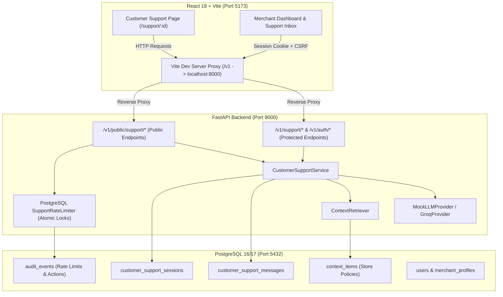
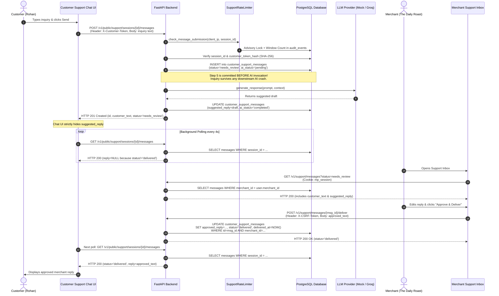

# 🎓 Magicpin AI Agent — College Internship Demo Guide

**Project Repository:** `ArjunReddyVelma/magicpin-ai-agent`
**Target Branch:** `feature/frontend-core`
**Verified Commit:** `a2f3d2fd72d3158e5485b19b74fa37da16b70201`
**Audience:** Internship Evaluators, Academic Mentors, and Engineering Reviewers

---

## Table of Contents
1. [Local Startup and Shutdown Guide](#1-local-startup-and-shutdown-guide)
2. [5-to-7 Minute Live Demo Script](#2-5-to-7-minute-live-demo-script)
3. [Architecture and End-to-End Data Flow](#3-architecture-and-end-to-end-data-flow)
4. [Mentor Questions and Answers (16 Q&As)](#4-mentor-questions-and-answers)
5. [Final Demo Verification Checklist](#5-final-demo-verification-checklist)
6. [Comprehensive Troubleshooting Guide](#6-comprehensive-troubleshooting-guide)

---

## 1. Local Startup and Shutdown Guide

### 1.1 Prerequisites
Ensure the following software is available on your local system (tested on macOS M-series / Apple Silicon):
- **Python**: `3.11+` (with active virtual environment in `.venv`)
- **Node.js**: `v18+` (v20 or v22 recommended; verified with v22.7)
- **PostgreSQL**: `16+` or `17+` running locally on port `5432`

---

### 1.2 Step-by-Step Startup

#### Step A: Verify PostgreSQL Service
Make sure PostgreSQL is active on `localhost:5432`:
```bash
# macOS Homebrew service check
brew services list | grep postgresql
# Quick connection check
pg_isready -h localhost -p 5432
```

#### Step B: Start FastAPI Backend (Terminal 1)
Run with the `LLM_PROVIDER=mock` environment variable override for an offline, deterministic, zero-API-cost demonstration:
```bash
cd /Users/reddy/Desktop/magicpin-ai-agent-main
source .venv/bin/activate
export LLM_PROVIDER=mock
uvicorn backend.app.main:app --host 127.0.0.1 --port 8000
```
*Expected log output:*
```text
INFO:     Started server process [PID]
INFO:     Waiting for application startup.
INFO:     Application startup complete.
INFO:     Uvicorn running on http://127.0.0.1:8000 (Press CTRL+C to quit)
```

#### Step C: Start Vite Frontend Server (Terminal 2)
```bash
cd /Users/reddy/Desktop/magicpin-ai-agent-main/frontend
npm run dev
```
*Expected log output:*
```text
  VITE v5.4.x  ready in 200 ms
  ➜  Local:   http://localhost:5173/
  ➜  Network: use --host to expose
```

---

### 1.3 Health Verification
Open a third terminal or your browser to verify service readiness:
```bash
# 1. Liveness check (200 OK)
curl -i http://127.0.0.1:8000/v1/healthz

# 2. Database readiness check (verifies PostgreSQL connection)
curl -i http://127.0.0.1:8000/v1/readyz

# 3. Frontend reverse-proxy verification (Vite -> FastAPI)
curl -i http://localhost:5173/v1/healthz
```
All checks must return `HTTP/1.1 200 OK`.

---

### 1.4 Safe Shutdown
To terminate only the demonstration processes without disturbing other system services:
```bash
# Stop backend and frontend processes
pkill -f "uvicorn backend.app.main:app"
pkill -f "vite"

# Verify ports 8000 and 5173 are free
lsof -i :8000 -i :5173
```

---

## 2. 5-to-7 Minute Live Demo Script

This script provides an exact chronological walkthrough designed for college project presentations and technical evaluations.

### Sequence Overview
```
[0:00 - 1:00] Problem Context & Architecture
[1:00 - 2:00] Merchant Registration & Knowledge Base Configuration
[2:00 - 3:30] Customer Public Chat & Inquiry Submission
[3:30 - 5:00] Merchant Inbox Review, Edit & Delivery Approval
[5:00 - 6:00] Customer View Verification & Polling Delivery
[6:00 - 7:00] Security, Rate Limiting & Architecture Wrap-Up
```

---

### Step 1: Introduction & Problem Statement (1 Minute)
- **Screen:** Show application landing page at `http://localhost:5173/` or Swagger docs at `http://127.0.0.1:8000/docs`.
- **Narration:**
  > *"Good morning. Today I am demonstrating the Magicpin AI Agent — a merchant support copilot and customer inquiry management platform designed for local commerce merchants.*
  > *Small merchants face hundreds of daily questions about menus, return policies, allergens, and order statuses. While LLMs can draft responses, autonomous chatbots risk hallucinating discounts, inventing store policies, or committing to impossible delivery times.*
  > *This project implements a strict Human-in-the-Loop architecture: the AI acts solely as a drafting assistant grounded in merchant-provided policies. Crucially, no message is ever sent to a customer until the merchant explicitly reviews, edits, and approves it."*

---

### Step 2: Fresh Merchant Registration & Store Context (1.5 Minutes)
- **Screen:** Browser Window 1 (Regular Chrome) -> `http://localhost:5173/`
- **Action:**
  1. Click **"Register a new merchant account"** below the login box.
  2. Fill in:
     - **Email:** `demo_cafe@example.com`
     - **Password:** `ValidPassword123!`
     - **Full Name:** `Arjun Reddy`
     - **Business Name:** `The Daily Roast Cafe`
     - **Category:** `Cafe & Roastery`
     - **Location:** `Indiranagar, Bengaluru`
  3. Click **"Create Workspace"**.
- **Expected Result:**
  - Fast redirection to the Merchant Dashboard.
  - Navbar shows `The Daily Roast Cafe`, category badge `Cafe & Roastery`, user email, and a green `Protected Session` badge.
  - An `HttpOnly`, `SameSite=Lax` session cookie (`mp_session`) is established, along with a session-bound HMAC CSRF token.
- **Add Store Policy / Context:**
  1. Click the **"Merchant Context"** tab in the Navbar (`http://localhost:5173/`).
  2. Click **"Add Context Item"** (top right).
  3. Fill in:
     - **Title:** `Dietary & Milk Alternatives Policy`
     - **Context Type:** `Store Policy` (`policy`)
     - **Content:** `We provide oat milk, almond milk, and soy milk for all espresso beverages at an additional Rs. 30. We bake certified gluten-free almond croissants and vegan banana walnut bread fresh daily.`
     - **Active Status:** Checked (`true`)
  4. Click **"Save Context"**.
  5. The item immediately renders with version `v1` and a green `Active` badge.
- **Fallback:** If registration indicates email already exists, either log in with `ValidPassword123!` or append a random digit (e.g., `demo_cafe2@example.com`).

---

### Step 3: Public Customer Support Chat (1.5 Minutes)
- **Screen:** Browser Window 2 (Chrome **Incognito** / Private Window)
  - *Note: Incognito ensures complete isolation from the merchant's authenticated session.*
- **URL:** `http://localhost:5173/support/<merchant_id>`
  - *Tip: The merchant ID is displayed in the dashboard profile card or can be retrieved from `/v1/auth/me`.*
- **Action:**
  1. Open the support link in Incognito.
  2. Point out: The customer sees the store's public profile (`The Daily Roast Cafe`, `Indiranagar, Bengaluru`, `Cafe & Roastery`). No confidential credentials, emails, or system IDs are exposed.
  3. Enter Customer Name: `Rohan`.
  4. Click **"Start Support Session"**.
  5. In the message box, enter a realistic question:
     `"Hi! Do you offer oat milk for lattes, and do you have any gluten-free pastries today?"`
  6. Click **"Send"** (or press Enter).
- **Expected Result:**
  - The message appears on the screen with a timestamp and a yellow badge: **"Waiting for merchant review"**.
  - **CRITICAL DEMO POINT (Highlight this to mentor):**
    > *"Notice that Rohan sees no AI response. The draft is strictly held in the merchant's private inbox. The customer cannot see unapproved AI suggestions."*
- **Fallback:** If the page says "Invalid merchant support link", check that the URL contains the valid UUID format from the registered merchant profile.

---

### Step 4: Merchant Support Inbox & Human-in-the-Loop Review (1.5 Minutes)
- **Screen:** Switch back to Browser Window 1 (Merchant Dashboard).
- **Action:**
  1. Click the **"Support Inbox"** tab in the Navbar.
  2. Show the filter: `Needs Review (1)`.
  3. Inspect the inquiry card:
     - Shows Customer Name (`Rohan`), inquiry text, and inquiry timestamp.
     - Features an **AI Suggestion** box highlighted with a Sparkles badge (`MockLLMProvider` output: `"This is a grounded response based on your merchant context."`).
  4. Point out that the merchant has full control: they can edit the text before delivering.
  5. Click into the editable reply field and customize the draft:
     `"Hi Rohan! Yes, we offer oat milk, almond milk, and soy milk (+Rs. 30) for all espresso drinks, and fresh gluten-free almond croissants daily!"`
  6. Click the green **"Approve & Deliver"** button.
- **Expected Result:**
  - Inflight spinner activates briefly; button changes to **"Delivered"** with a green checkmark.
  - The card moves from `Needs Review` to `Delivered`.
  - State transition is atomically recorded in PostgreSQL with timestamp `delivered_at`.
- **Fallback:** If repeated click occurs, observe that the UI inflight lock drops duplicate submissions, and the backend returns `409 Conflict` (`MESSAGE_ALREADY_DELIVERED`) to preserve idempotency.

---

### Step 5: Verification of Customer Delivery (1 Minute)
- **Screen:** Switch back to Browser Window 2 (Customer Incognito Chat).
- **Action:** Observe the screen without refreshing.
- **Expected Result:**
  - Within 4 seconds (the background polling engine), the status changes from `Waiting for merchant review` to **`Delivered`**.
  - The approved merchant response bubble appears:
    `"Hi Rohan! Yes, we offer oat milk, almond milk, and soy milk (+Rs. 30) for all espresso drinks, and fresh gluten-free almond croissants daily!"`
- **Narration:**
  > *"The customer's browser safely polled the server, and because the merchant approved the reply, the response was released to the customer. This proves the full end-to-end Human-in-the-Loop lifecycle."*

---

### Step 6: Wrap-Up & Technical Summary (30 Seconds)
- **Summary Points:**
  - Grounded in merchant policy (not hallucinated).
  - Human review required before external dispatch.
  - Full relational audit trail in PostgreSQL.
  - Isolated multi-tenant security architecture.

---

## 3. Architecture and End-to-End Data Flow

### 3.1 High-Level Component Architecture



---

### 3.2 Step-by-Step Life of a Customer Inquiry

Here is the exact technical trace of a customer inquiry from keystroke to delivered answer:



---

## 4. Mentor Questions and Answers

### Q1: What core problem does this project solve?
**Answer:** Small and medium merchants on commerce platforms face heavy inquiry volumes regarding order delays, return policies, store hours, and dietary options. Generic chatbots hallucinate promises or discounts, while manual answering leads to long customer wait times. This project solves that dilemma with a **Human-in-the-Loop Copilot**: the AI reads verified merchant policies and drafts suggested responses, but **never** sends anything directly to customers. The merchant reviews, edits, and delivers every reply with one click.

### Q2: Why did you choose this technology stack (React, FastAPI, PostgreSQL)?
**Answer:**
- **FastAPI (Python):** Chosen for native async support, strict schema validation via Pydantic v2, auto-generated OpenAPI documentation, and seamless integration with Python AI/LLM SDKs.
- **PostgreSQL 16/17:** Chosen for relational integrity, JSONB support for audit events, advisory locking (`pg_advisory_xact_lock`) for race-free rate limiting, and robust ACID transaction semantics.
- **React 18 + Vite + TypeScript:** Provides component modularity, instant hot-module replacement for local development, and strict type safety across client-server API payloads.

### Q3: What happens when a customer sends an inquiry?
**Answer:**
1. The request hits `POST /v1/public/support/sessions/{id}/messages` with client IP and an `X-Customer-Token` header.
2. The `SupportRateLimiter` verifies that neither IP nor session quotas are exceeded under an advisory lock.
3. The session token is validated against the database using constant-time hash comparison (`hmac.compare_digest`).
4. The inquiry is **immediately committed to PostgreSQL** with `status="needs_review"` and `ai_status="pending"`.
5. Only then does the backend invoke the LLM to generate a draft.
6. Once the draft returns, the row is updated with `suggested_reply` and `ai_status="completed"`.

### Q4: How does the AI use merchant context?
**Answer:** When an inquiry arrives, the `ContextRetriever` queries active knowledge records in the `context_items` table belonging strictly to that merchant's UUID. It formats these items into a `<merchant_context>` XML block inside the system prompt and explicitly instructs the model:
`"Ground your reply strictly in the provided merchant context. Never invent prices, availability, delivery timelines, policies, or promises not in the context."`

### Q5: Why must a merchant review the suggested response?
**Answer:** In local commerce, incorrect information directly causes financial or legal liability (e.g., promising a refund against store policy or giving incorrect allergen information). Autonomous AI cannot be held liable; the merchant must retain full ownership of customer communications. Human review guarantees 100% policy compliance while saving 80% of typing time.

### Q6: How is chat history stored and retrieved?
**Answer:** Chat sessions and messages are stored in relational tables `customer_support_sessions` and `customer_support_messages` with composite foreign keys linking them to `merchant_profiles`. When a customer polls `/messages`, the backend executes `SELECT ... WHERE session_id = :id ORDER BY created_at ASC`. Critically, the serializer checks:
`reply = message.approved_reply if message.status == "delivered" else None`.
This guarantees that unapproved drafts are never leaked over the wire.

### Q7: How is multi-tenant isolation enforced?
**Answer:** Tenant boundaries are derived exclusively on the server from the authenticated user session. The client never passes a trusted `merchant_id` in headers or body for protected operations. The dependency `get_current_merchant()` queries the `merchant_profiles` table where `user_id == session.user_id`. Every database update and query filters on `merchant_id == merchant.id`. Attempting to access or approve another merchant's message triggers an immediate `HTTP 404/403`.

### Q8: How does rate limiting work?
**Answer:** The project uses a persistent, PostgreSQL-backed token-bucket event log in `audit_events`. To eliminate race conditions where concurrent requests bypass quotas, it computes a deterministic 64-bit integer hash from the bucket key and acquires a PostgreSQL transaction-level advisory lock (`pg_advisory_xact_lock`). Inside the lock, it counts events within the sliding window; if quota remains, it inserts the audit event. If exceeded, it raises `HTTP 429 Too Many Requests`.

### Q9: What happens if the AI provider (e.g., Groq) is down or times out?
**Answer:** The application is architected to **fail gracefully**:
1. Because the inquiry is persisted in step 4 before calling the LLM, the customer's question is never lost.
2. If the LLM call times out or raises an exception, the exception is caught, logged, and the message row is updated with `ai_status="failed"` and `suggested_reply=None`.
3. In the Merchant Support Inbox, the inquiry still appears in the `Needs Review` queue with an alert: `"AI draft generation failed; please write a manual response."`
4. The merchant can type their reply manually and deliver it without interruption.

### Q10: How are database migrations managed?
**Answer:** Database migrations are handled using Alembic. Revisions are sequential (`0001_initial_schema` -> `0002_whatsapp_business_mvp` -> `0003_web_customer_support` -> `0004_rate_limit_optimization`). Both `upgrade()` and `downgrade()` functions are written and tested. Migration `0004` adds a functional index `ix_audit_events_rate_limiting` on JSONB metadata without altering or deleting existing table rows.

### Q11: What testing strategy was implemented?
**Answer:** The repository includes comprehensive, multi-layer automated tests:
- **Frontend (84 tests):** Node.js test runner covering UI state transitions, API client serialization, CSRF attachment, polling engine lifecycle, and inflight click deduplication.
- **Backend Unit (68 tests):** Pytest suite covering Argon2id hashing, CSRF verification, trusted proxy IP extraction, and isolation safeguards.
- **Backend Integration & Concurrency (24 tests):** Tests database schema constraints, foreign key cascading, Alembic upgrade/downgrade cycles, and parallel multi-threaded concurrent advisory locks.
- **End-to-End Test Script (11 steps):** Verifies the live HTTP request lifecycle from health check to registration, inquiry, review, delivery, and 409 conflict handling.

### Q12: How are secrets and session security managed?
**Answer:**
- Passwords are encrypted using **Argon2id** (memory-hard, resistant to GPU attacks).
- Session tokens are generated as 256-bit cryptographically secure random bytes, transmitted via an `HttpOnly`, `SameSite=Lax` cookie, and stored in the database only as SHA-256 hashes.
- CSRF protection uses an HMAC of the session ID and user ID signed with a server secret (`X-CSRF-Token`).
- Secrets in `.env` are never printed in logs or transmitted to the client.

### Q13: What is the purpose of `LLM_PROVIDER=mock`?
**Answer:** `MockLLMProvider` is an in-memory, controllable implementation of the `LLMProvider` abstract base class. It generates deterministic grounded responses without requiring external internet connectivity, third-party API accounts, or API token credits. It ensures that CI pipelines, automated tests, and live academic demonstrations can run 100% reliably offline.

### Q14: What is the status of the WhatsApp integration?
**Answer:** The WhatsApp Cloud API integration is an educational MVP component designed for Meta webhooks and local mock testing (on the dedicated `feature/whatsapp-mock-mode` branch). Because live WhatsApp delivery requires verified Meta Business Manager credentials, registered phone numbers, and approved message templates, it is documented as a roadmap integration rather than a production consumer service.

### Q15: What are the current limitations of the project?
**Answer:**
1. Customer message delivery currently relies on HTTP polling (every 4 seconds) rather than WebSockets or Server-Sent Events (SSE).
2. The mock LLM returns a static canned response rather than dynamic embeddings or vector retrieval.
3. Media attachment (images, PDF bills) is not yet supported in web chat; messages are plain text only.

### Q16: What would you improve in the next release?
**Answer:**
1. **WebSockets / SSE:** Replace the 4-second polling engine with bidirectional WebSocket channels for instantaneous customer delivery.
2. **Vector Embeddings (pgvector):** Integrate `pgvector` inside PostgreSQL to perform semantic similarity search over large merchant catalogs and policy documents.
3. **Analytics Dashboard:** Track merchant response times, AI draft acceptance rates, and frequent customer topics to provide business intelligence.

---

## 5. Final Demo Verification Checklist

Print or reference this checklist before presenting:

- [ ] **Environment**: PostgreSQL 16/17 running locally on `localhost:5432`.
- [ ] **Backend Process**: `uvicorn` running with `LLM_PROVIDER=mock` on port `8000`.
- [ ] **Frontend Process**: `vite` dev server running on port `5173`.
- [ ] **Liveness**: `curl -s http://127.0.0.1:8000/v1/healthz` returns `{"status":"ok"}`.
- [ ] **Readiness**: `curl -s http://127.0.0.1:8000/v1/readyz` returns `{"status":"ready","checks":{"database":"ok"}}`.
- [ ] **Frontend Proxy**: `curl -s http://localhost:5173/v1/healthz` returns `{"status":"ok"}`.
- [ ] **Database Migration**: `alembic current` confirms `0004_rate_limit_optimization (head)`.
- [ ] **Browser Prep**: Window 1 open to `http://localhost:5173/` (Merchant); Window 2 open in Incognito (Customer).
- [ ] **Test Merchant**: Fresh email ready (e.g., `demo_cafe@example.com`).
- [ ] **Context Ready**: Store policy entered and marked `Active`.
- [ ] **Inquiry Prepared**: Realistic question ready to type or paste.
- [ ] **Delivery Verified**: Confirmed that approving in Window 1 updates Window 2 within 4 seconds.
- [ ] **Cleanup**: Know the `pkill` command to shut down services cleanly after evaluation.

---

## 6. Comprehensive Troubleshooting Guide

### Issue 1: Port 8000 or 5173 Already in Use
- **Symptom:** `OSError: [Errno 48] Address already in use` or Vite selecting port `5174`.
- **Cause:** A previous instance of `uvicorn` or `vite` is still running.
- **Fix:**
  ```bash
  lsof -ti :8000 | xargs kill -9 2>/dev/null
  lsof -ti :5173 | xargs kill -9 2>/dev/null
  ```

### Issue 2: PostgreSQL Connection Refused
- **Symptom:** Backend returns `HTTP 503` on `/v1/readyz` with `DEPENDENCY_UNAVAILABLE`.
- **Cause:** PostgreSQL service stopped or not accepting TCP connections on port 5432.
- **Fix:**
  ```bash
  # Check service
  brew services restart postgresql@17  # (or your installed postgresql version)
  # Verify ready
  pg_isready -h localhost -p 5432
  ```

### Issue 3: Missing Alembic Migration on Development DB
- **Symptom:** Backend crashes on inquiry submission with `relation "ix_audit_events_rate_limiting" does not exist`.
- **Cause:** Migration `0004` has not been applied to `magicpin_ai_agent`.
- **Fix:**
  ```bash
  source .venv/bin/activate
  alembic -c backend/alembic.ini upgrade head
  ```

### Issue 4: CSRF Header Missing or Invalid (403 Forbidden)
- **Symptom:** Merchant action (e.g., delivery or saving context) returns `403 Forbidden` with `CSRF_TOKEN_INVALID`.
- **Cause:** Browser session cookie expired or client state cleared while keeping tab open.
- **Fix:** Click **"Sign Out"** in the Navbar and log back in. The login endpoint issues a fresh CSRF token.

### Issue 5: Customer Sees Empty Profile or 404
- **Symptom:** Support page shows `"Merchant not found or inactive"`.
- **Cause:** URL contains a typo or invalid UUID format.
- **Fix:** Verify the merchant UUID from `GET /v1/auth/me` or the Dashboard profile card, and format as `http://localhost:5173/support/<uuid>`.

### Issue 6: Rate Limit 429 During Rapid Testing
- **Symptom:** `HTTP 429 Too Many Requests` on creating sessions or submitting messages.
- **Cause:** Sliding window quota exceeded (e.g., more than 5 inquiries within 60 seconds from same IP/session).
- **Fix:** Wait 60 seconds for the sliding window to roll over, or create a new support session with a fresh customer name.
